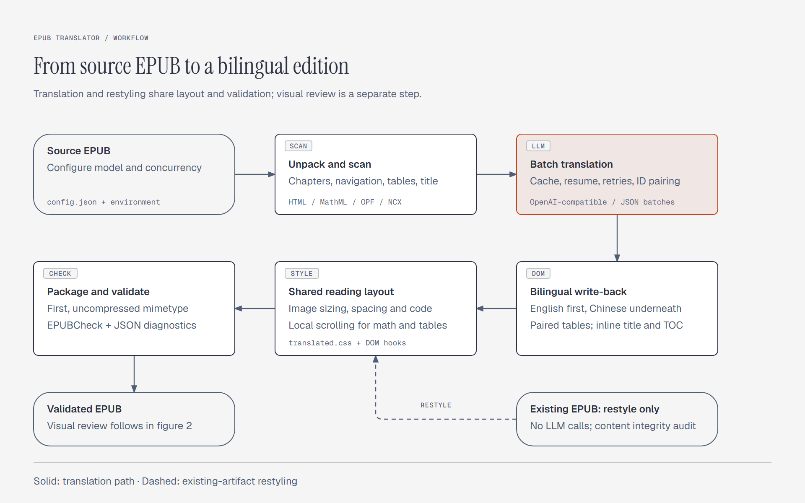
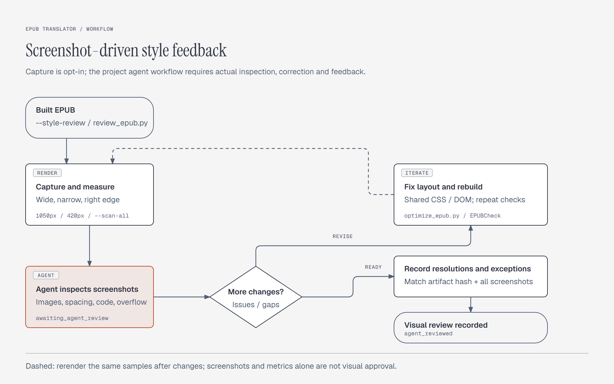

# epub-translator

> Version: 1.3.0 · Documentation updated: 2026-10-19

Translate English EPUBs **paragraph by paragraph into Chinese**, placing each Chinese
translation directly under the original English paragraph to form a bilingual layout
("English on top, Chinese below"). Built on any OpenAI-compatible model (DeepSeek / OpenAI /
Qwen / GLM / self-hosted gateway), with a thread pool for parallel dispatch, cache
deduplication and resume support.

[简体中文](README.md)

## Workflow and capabilities

There are three entry points: `translate_epub.py` creates a bilingual edition, `optimize_epub.py` restyles an existing artifact, and `review_epub.py` renders the packaged EPUB and prepares an agent review. Translation and restyling share the reading layout and run EPUBCheck by default. Screenshot capture is enabled with `--style-review` or the standalone command.



The diagram shows the path after successful validation. Restyling makes no translation API calls and additionally audits content and resource preservation. See [Screenshot feedback workflow](#screenshot-feedback-workflow) for the visual review stage.

| Capability | Current behavior |
|---|---|
| Models and execution | OpenAI-compatible providers; configuration and environment overrides; token-budgeted JSON batches with per-batch IDs, parallel requests, cache deduplication, resume, retries and fallback handling |
| Content and structure | Code blocks are not translated and indentation is retained. Inline code uses `<code data-epub-inline-code="N">…</code>` markers and restores the original nodes. MathML, formula images and placeholders are protected; TeX inside figure descriptions no longer misclassifies diagrams |
| Bilingual organization | English above Chinese in body text; inline `English · Chinese` titles and TOC entries; a complete Chinese table below the original. EPUB3 navigation, EPUB2 NCX and Springer/Apress captions, listings, printed contents and index terms are supported |
| Reading layout | Separate serif, sans-serif and monospace treatments for body, headings and code, with paired paragraph spacing. Figures, portraits, covers and glyphs have distinct sizing; panoramas, wide code, math and tables scroll locally |
| Artifacts and checks | Translated title filenames; first, uncompressed `mimetype`; EPUBCheck JSON diagnostics by default. Errors or unavailable tooling return nonzero status. Restyling compares content and unchanged resources before replacing the output |
| Screenshots and feedback | Wide/narrow sampling, right-edge captures, an all-document narrow scan and comparison galleries. An agent inspects actual PNGs, corrects and rerenders, then records feedback bound to the artifact hash and every screenshot |

## When to use

- You have an English (or other foreign-language) EPUB and want it translated to Chinese,
  made into a bilingual edition, or "localized".
- You want to keep the original text for reference while adding Chinese translations
  (not replacing the original).

## Directory layout (follows the SkillHub recommended Skill format)

```
epub-translator/
├── SKILL.md                  # The only required file: YAML metadata + Markdown instructions
├── README.md / README.en.md  # CN / EN docs
├── pyproject.toml / uv.lock  # uv dependency metadata and lockfile
├── requirements.txt          # pip compatibility install list
├── config.example.json       # Config template (committed, placeholder, safe)
├── config.json               # Real config (gitignored, contains API key, never commit)
├── scripts/
│   ├── translate_epub.py     # Unpack -> scan -> translate -> write back -> package
│   ├── optimize_epub.py      # Restyle existing EPUBs with content preservation
│   ├── review_epub.py        # Screenshots, layout metrics and agent feedback
│   └── render_workflow_diagrams.py # Bilingual README diagrams and PNG export
├── assets/
│   ├── translated.css        # Built-in bilingual reader stylesheet
│   ├── legacy-image-sizing.css # Legacy image-only repair rules
│   └── diagrams/             # HTML diagram sources, PNGs and render audit
└── tests/
    └── test_inline_code.py   # Unit tests: inline-code protection, reasoning control, formula detection
```

## Configuration (OpenAI-compatible, no hardcoded keys)

All sensitive / service fields live in `config.json`; upper-case environment variables
override individual fields with highest priority. The repo ships only the
`config.example.json` template:

```jsonc
{
    "model_name": "deepseek-v4-flash",
    "api_key":    "sk-YOUR_API_KEY_HERE",   // prefer the API_KEY env var
    "base_url":   "https://api.deepseek.com", // without /chat/completions
    "reasoning_mode": "disabled",            // disable thinking for translation by default
    "reasoning_provider": "auto",            // auto / openai / deepseek / qwen / zhipu / ark / generic
    "extra_body": {},
    "batch_tokens": 12000,                   // per-batch token budget (input side, optional)
    "system_prompt": "..."                   // prompt for the batch JSON protocol
}
```

Before first use, copy the template and fill in your key (or leave it empty and inject via
environment variables): `cp config.example.json config.json`. On PowerShell, use
`Copy-Item config.example.json config.json`. File lookup priority is: `--config` >
`config.json` in `scripts/` > `config.json` in the project root or current directory >
`config.example.json`. Environment variables override fields only; they do not choose the
configuration file.

> `batch_tokens` can also be overridden via the CLI flag `--batch-tokens` or the
> `BATCH_TOKENS` env var. If you customize `system_prompt`, it must match the batch protocol
> (input `[{"id","text"}]`, output `[{"id","zh"}]`) or the script cannot parse the reply.

### Reasoning control

Translation disables thinking by default. Supported OpenAI models receive reasoning_effort:
none (or low for older reasoning models); DeepSeek, Ark, and Zhipu receive thinking.type:
disabled; Qwen receives enable_thinking: false. The script overrides conflicting fields in
extra_body.

reasoning_provider defaults to auto and is inferred from base_url. A self-hosted or
aggregation gateway can explicitly select openai, deepseek, qwen, zhipu, ark, or generic;
unknown gateways receive no speculative reasoning field. REASONING_MODE and
REASONING_PROVIDER provide temporary overrides.

## Dependencies

```bash
uv sync --locked
```

Dependencies are declared in `pyproject.toml` and exact versions are recorded in `uv.lock`.
After changing dependencies, run `uv lock` and commit the lockfile. `lxml` is optional:
install it with `uv sync --locked --extra xml` when needed. `pip install -r requirements.txt`
remains available, while uv is the recommended dependency workflow.

## Usage

```bash
# The second argument selects the output directory; the filename is translated automatically.
uv run --locked python scripts/translate_epub.py input.epub output/placeholder.epub
```

Optional flags:

- `--config <path>`: explicitly select a configuration file.
- `--concurrency <n>`: concurrent requests; default `64`.
- `--batch-tokens <n>`: input-side token budget for each batch; defaults to the config
  value or `12000`.
- `--work-dir <path>`: directory for temporary extraction and cache files.
- `--resume`: reuse `cache.json` from the work directory; the source EPUB is still
  unpacked again to prevent duplicate translations.

PowerShell example:

```powershell
uv run --locked python scripts/translate_epub.py input.epub output/placeholder.epub --config config.json --concurrency 64 --batch-tokens 12000 --resume
```

### Request-count reduction from batching

A ~3300-paragraph book (avg 141 chars) used to need ~3300 API calls (one per paragraph).
With the batch protocol at ~12000 input tokens per batch (~90-120 paragraphs), the total
drops to **~30 requests** (1-2 orders of magnitude), and the system-prompt overhead shrinks
from ~45% of total input to <5%. Throughput still scales near-linearly with concurrency:

| Concurrency | Time | Rate (para/s) |
|---|---|---|
| 16 | 15.5s | ~12.9 |
| 64 | 4.0s  | ~49.5 |
| 96 | 3.2s  | ~62.8 |

> The speedup ceiling depends on API-side concurrency/rate limits; if a gateway is unstable
> on long outputs, lower `--batch-tokens` (e.g. 6000-8000); missing items are retried
> individually.

## Security notes

- `config.json` holds your real API key and is excluded by `.gitignore` — **never commit it**.
- Recommended: store only `model_name` / `base_url` / `extra_body` / `system_prompt` in
  `config.json`; inject `api_key` via the `API_KEY` environment variable.
- Translating copyrighted ebooks (Kindle/O'Reilly/Apress, etc.) you obtained legitimately
  is for personal study only; do not redistribute.

## Output and compatibility

- The EPUB is written to the directory supplied by the second argument and named after the
  translated OPF title, for example `Python 专家编程（第四版）.epub`.
- A candidate EPUB is checked through the Python API of PyPI `epubcheck==5.3.0` before replacing
  the final output. A matching `.epubcheck.json` report is saved on success. Errors exit nonzero
  and save a separate `.failed.epub` and `.failed.epubcheck.json`; an unavailable checker saves
  an unchecked candidate. Existing final output is preserved. Warnings require review.
  Java must be installed and available as `java` on PATH.
- Scan, writeback and protected-content failures stop generation. Empty translations and
  lost code/math/URL markers are rejected from cache; `--resume` retries them while reusing
  valid entries. Work-directory cleanup only removes its dedicated extraction child.
- The reader stylesheet is already built in. Apply any font subsetting or reader-specific
  fixes directly in this project when they are needed.
- `.gitignore` excludes real configuration, generated EPUBs, caches, and both temporary
  working-directory patterns.

## Tests

```bash
uv run --locked python -m unittest discover -s tests -v
```

For the full translation-unit rules, publisher adaptation notes, the system prompt,
placeholder protection, and error handling, see [SKILL.md](SKILL.md).

See the [workflow audit](docs/workflow-audit.md) for findings and verification scope. Integration
tests use a local OpenAI-compatible HTTP fixture without real credentials or paid API calls;
EPUBCheck and Chromium checks use the actual tools.

## Screenshot feedback workflow



Capture starts in `awaiting_agent_review`. The agent must inspect actual PNGs. If changes are needed, update shared styles or classification, rebuild and validate the EPUB, then rerender the same samples. Record the final review only after resolving findings or explaining accepted limitations.

Install optional tooling with `uv sync --locked --extra review` and `uv run --locked --extra review python -m playwright install chromium`. Pass `--browser-executable` for an existing Chromium installation.

```powershell
uv run --locked --extra review python scripts/review_epub.py input.epub --output .style-review-book/before
uv run --locked python scripts/optimize_epub.py input.epub output/styled.epub
uv run --locked --extra review python scripts/review_epub.py output/styled.epub --output .style-review-book/after --plan .style-review-book/before/samples.json --compare .style-review-book/before/report.json --scan-all
```

Translation also accepts `--style-review`, `--review-dir` and `--browser-executable`. Each iteration needs a new review directory. The optimizer's second argument is an exact filename; matching input/output explicitly requests in-place optimization. Failed validation does not replace the input. `--skip-epubcheck` is for development and records an unchecked result.

Sampling combines six evenly distributed spine locations with available heading levels, body pairs, code, figures, portraits, math, tables, lists and navigation at 1050px and 420px. These are reflowed viewports, not fixed EPUB page numbers. `--scan-all` scans every HTML document at the narrow width. Screenshots come from the final EPUB, without screenshot-only CSS.

An agent must inspect the actual PNGs and metrics, fix shared CSS/DOM logic, rebuild, then rerender using the same sample plan. Fill `feedback.template.json` into `feedback.json` with the final artifact hash, `status: reviewed`, a summary, every reviewed screenshot filename, and findings containing screenshot, issue, change, reason and resolved/accepted status. Record completion using:

```powershell
uv run --locked --extra review python scripts/review_epub.py output/styled.epub --output .style-review-book/after --accept-feedback .style-review-book/after/feedback.json
```

The default status is `awaiting_agent_review`. Both the EPUB and each PNG have SHA-256 hashes.
Stale hashes, missing screenshot coverage and render errors cannot close a review. Render errors
record `render_failed` and exit nonzero. Every `issues[].id` must be linked in feedback `issue_ids`;
current candidates require an explicit `accepted` reason, or a fix followed by a new render.
Automatic metrics are candidates for inspection, not visual approval. Report unavailable categories
and accepted limitations. Chromium checks do not certify pagination in all EPUB readers.
See SKILL.md for the required agent procedure.

Set `EPUB_REVIEW_BROWSER` to a Chromium executable and run tests with `--extra review` to include the real-browser regression test.

## Maintaining the workflow diagrams

The README embeds PNGs from `assets/diagrams/`; matching editable HTML sources are retained. Each of the two figures has Chinese and English versions, using Diagram Design's default light style on a 960×600 canvas, exported to 1920×1200 PNG. Regenerate after workflow changes:

```powershell
uv run --locked --extra review python scripts/render_workflow_diagrams.py --export
```

Use `--browser-executable <path>` for an existing Chromium. The renderer checks text bounds and narrow-screen local scrolling, and records actual loaded fonts in `assets/diagrams/render-audit.json`. See the [diagram source notes](assets/diagrams/README.md) for scope and maintenance details.
