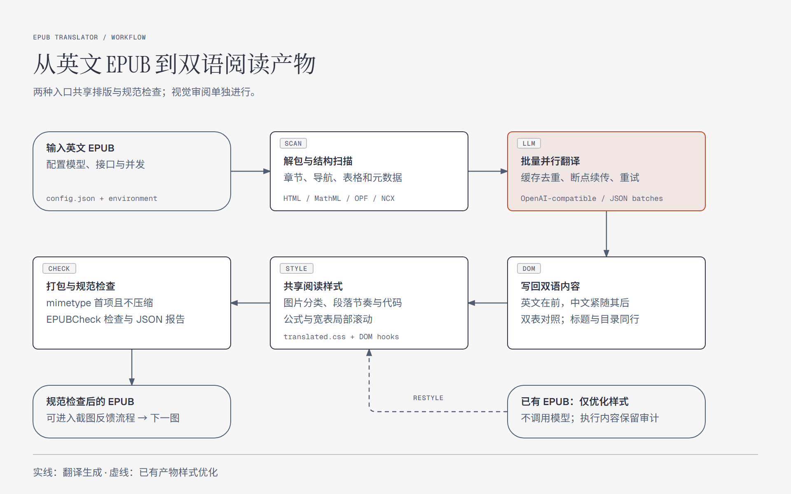
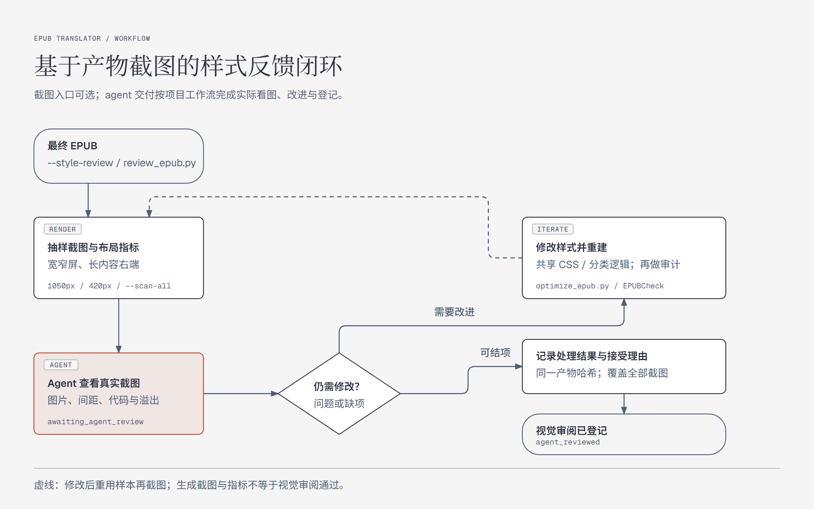

# epub-translator

> 版本：1.4.0 · 文档更新：2026-10-19

将英文 EPUB 文件**逐段翻译为中文**，并把中文译文放在原英文段落的紧下方，形成「英在上、中在下」的双语对照排版。翻译基于任意 OpenAI 兼容模型（DeepSeek / OpenAI / 通义千问 / 智谱 / 自建网关 等），通过线程池并行调度，支持缓存去重与断点续传。

[English](README.en.md)

项目版本以 `pyproject.toml` 为准，并与 `uv.lock`、中英文 README 和 `SKILL.md` 同步。当前版本发布为 [`v1.4.0`](https://github.com/samonysh/epub-translator/releases/tag/v1.4.0)（2026-10-19）；版本变化见 [CHANGELOG.md](CHANGELOG.md)。

## 工作流与特性

项目有三种入口：`translate_epub.py` 翻译并生成双语 EPUB，`optimize_epub.py` 优化已有产物的样式，`review_epub.py` 对打包后的 EPUB 截图并准备 agent 审阅材料。翻译与样式优化共享阅读样式，默认运行 EPUBCheck；截图流程通过 `--style-review` 或独立命令启用。



图中展示规范检查成功后的主线；仅优化样式不调用翻译 API，并额外检查内容与资源保留。截图反馈详见[样式优化与截图反馈](#样式优化与截图反馈)。

| 能力 | 当前行为 |
|---|---|
| 模型与执行 | 兼容 OpenAI 风格接口；配置与环境变量驱动；按 token 预算动态分批，JSON 批内 ID 配对，并行请求、缓存去重、断点续传和重试兜底 |
| 内容与结构保护 | 代码块不翻译，保留缩进；行内代码通过 `<code data-epub-inline-code="N">…</code>` 交给模型并恢复原节点。保护 MathML、公式图片与占位符，修正图注含 TeX 导致的插图误判 |
| 双语组织 | 正文英上中下，标题与目录“英文 · 中文”；原表下追加完整中文表。兼容 EPUB3 导航、EPUB2 NCX，以及 Springer/Apress 图注、代码说明、印刷目录和索引 |
| 阅读排版 | 正文、标题与代码分别使用衬线、无衬线和等宽字体；中英段落有明确配对节奏。插图、照片、封面、公式与图标分别限幅，超宽图、代码、公式和宽表局部滚动 |
| 产物与检查 | 译作按中文书名命名；`mimetype` 首项且不压缩。默认输出 EPUBCheck JSON 报告，错误或工具不可用时返回非零状态；仅优化样式时逐项核对内容与未修改资源 |
| 截图与反馈 | 宽窄屏抽样、长内容右端截图、全书窄屏布局扫描和前后图库；agent 实际看图后改进与复查，再以产物哈希和逐张截图记录登记反馈 |

## 何时使用

- 用户提供英文（或其他外文）EPUB，要求「翻译成中文 / 做中英对照版 / 汉化这本书」。
- 希望保留原文阅读体验的同时增加中文译文（不替换原文）。

## 目录结构（遵循 SkillHub 推荐 Skill 格式）

```
epub-translator/
├── SKILL.md                  # Skill 唯一必需文件：YAML 元数据 + Markdown 指令
├── README.md / README.en.md  # 中英文说明
├── pyproject.toml / uv.lock  # uv 依赖声明与锁文件
├── requirements.txt          # pip 兼容安装入口
├── config.example.json       # 配置模板（仓库内，含占位符，安全）
├── config.json               # 真实配置（gitignored，含 API key，勿提交）
├── scripts/
│   ├── translate_epub.py     # 主脚本：解包 → 提取 → 并行翻译 → 写回 → 打包
│   ├── optimize_epub.py      # 已生成 EPUB 的保内容样式优化
│   ├── review_epub.py        # 抽样截图、布局指标与 agent 反馈闭环
│   └── render_workflow_diagrams.py # README 中英文流程图与 PNG 导出
├── assets/
│   ├── translated.css        # 内建双语阅读样式
│   ├── legacy-image-sizing.css # 旧版图片专项修复规则
│   └── diagrams/             # 中英文 HTML 图源、PNG 与渲染记录
└── tests/
    └── test_inline_code.py   # 单元测试：行内代码保护、推理控制、公式识别
```

## 配置（OpenAI 兼容，不硬编码密钥）

所有敏感与服务字段通过 `config.json` 配置；同名大写环境变量可覆盖其中的字段（最高优先级）。
仓库只提供 `config.example.json` 模板：

```jsonc
{
    "model_name": "deepseek-v4-flash",
    "api_key":    "sk-YOUR_API_KEY_HERE",   // 建议改用环境变量 API_KEY
    "base_url":   "https://api.deepseek.com", // 不含 /chat/completions
    "reasoning_mode": "disabled",            // 翻译默认关闭思考
    "reasoning_provider": "auto",            // auto / openai / deepseek / qwen / zhipu / ark / generic
    "extra_body": {},
    "batch_tokens": 12000,                   // 单批预估 token 预算（输入侧，可选）
    "system_prompt": "..."                   // 批量 JSON 协议专用 prompt
}
```

使用前复制模板并填入真实 key（或留空，用环境变量注入）：

```powershell
Copy-Item config.example.json config.json
```

在 Bash 中可使用 `cp config.example.json config.json`。配置文件查找优先级为：命令行
`--config` > `scripts/` 目录中的 `config.json` > 项目根目录或当前目录的 `config.json` >
`config.example.json`；环境变量仅覆盖配置字段，不决定配置文件路径。

> `batch_tokens` 亦可用 CLI `--batch-tokens` 或环境变量 `BATCH_TOKENS` 覆盖。
> 若自定义 `system_prompt`，必须与批量协议一致（输入 `[{"id","text"}]`，输出 `[{"id","zh"}]`），否则脚本无法解析模型返回。

### 推理控制

翻译默认关闭思考。支持的 OpenAI 模型使用 reasoning_effort: none（旧推理模型降为
low）；DeepSeek、方舟和智谱使用 thinking.type: disabled；Qwen 使用
enable_thinking: false。脚本会覆盖 extra_body 中可能意外开启思考的同名字段。

reasoning_provider 默认为 auto，并按 base_url 识别供应商。自建或聚合网关可显式设为
openai、deepseek、qwen、zhipu、ark 或 generic；未知网关不会收到猜测性的推理参数。
REASONING_MODE 与 REASONING_PROVIDER 可临时覆盖设置。

## 依赖

```bash
uv sync --locked
```

依赖声明在 `pyproject.toml`，精确版本记录在 `uv.lock`；更新依赖后运行 `uv lock` 并提交锁文件。`lxml` 可选，需要时运行 `uv sync --locked --extra xml`。仍可使用 `pip install -r requirements.txt`，但 uv 是推荐的依赖管理方式。产物检查使用 PyPI `epubcheck==5.3.0` 的 Python API；该包附带 EPUBCheck，但系统仍须安装 Java 并使 `java` 可在命令行运行。

## 用法

```bash
# 基本用法：第二个参数仅指定输出目录；最终文件名自动使用中文书名
uv run --locked python scripts/translate_epub.py input.epub output/placeholder.epub
```

可选参数：

- `--config <path>`：显式指定配置文件。
- `--concurrency <n>`：并发请求数，默认 `64`。
- `--batch-tokens <n>`：单批输入侧 token 预算；默认读取配置或使用 `12000`。
- `--work-dir <path>`：临时解包与缓存目录。
- `--resume`：复用该工作目录中的 `cache.json`；源 EPUB 仍会重新解包，避免重复写入译文。
- `--style-review`：对打包后的 EPUB 生成截图、指标、图库及 agent 审阅任务。
- `--review-dir <path>`：截图审阅目录；每次迭代使用新目录。
- `--browser-executable <path>`：可选 Chromium 路径；默认使用 Playwright 安装的 Chromium。

PowerShell 示例：

```powershell
uv run --locked python scripts/translate_epub.py input.epub output/placeholder.epub --config config.json --concurrency 64 --batch-tokens 12000 --resume
```

### 批量协议带来的请求数压缩

整本 ~3300 段（平均 141 字符）的书，旧版每段一次请求需 ~3300 次 API 调用；
批量协议下单批 12000 tokens（约 90~120 段），总请求数降至 **~30 次**（1~2 个数量级），
且 system_prompt 开销从占总输入约 45% 摊薄到 <5%。实测并发仍可近线性扩展：

| 并发 | 耗时 | 速率（段/秒） |
|---|---|---|
| 16 | 15.5s | ~12.9 |
| 64 | 4.0s  | ~49.5 |
| 96 | 3.2s  | ~62.8 |

> 提速上限受 API 侧并发/限流影响；若网关对长输出不稳定，调小 `--batch-tokens`（如 6000~8000），缺失条目会自动单条兜底。

## 安全建议

- `config.json` 含真实 API key，已被 `.gitignore` 排除，**切勿提交**。
- 推荐：`config.json` 只写 `model_name` / `base_url` / `extra_body` / `system_prompt`，
  `api_key` 通过环境变量 `API_KEY` 注入。
- 复刻他人的 Kindle/O'Reilly/Apress 等受版权电子书用于翻译仅限个人学习，请勿传播。

## 输出与兼容性

- 输出 EPUB 位于第二个命令参数所在的目录，文件名为 OPF 书名的中文译名，例如 `Python 专家编程（第四版）.epub`。
- 候选包自动运行 EPUBCheck，通过后才替换正式输出，并保存同名 `.epubcheck.json` 报告。检查失败返回非零退出码，另存 `.failed.epub` 与 `.failed.epubcheck.json` 供诊断，已有正式输出保持原样；工具无法运行时另存未检查候选包。仅有警告时仍可成功结束，但需审阅报告。
- 扫描、写回或译文保护校验失败时停止生成；空译文和缺失代码/公式/URL 标记的译文不会作为有效缓存。修复后以 `--resume` 复用有效条目。工作目录只清理专属解包子目录，不删除不相关文件。
- 成品已内建阅读样式。仅在需要字体子集化、公式图片结构修复或某个阅读器的定向兼容时，再在项目内做定向处理。
- `.gitignore` 已排除真实配置、生成的 EPUB、缓存与两种临时工作目录。

## 样式优化与截图反馈



截图与指标生成后状态为 `awaiting_agent_review`。Agent 需要实际查看 PNG；如需修改，则更新共享样式或分类逻辑，重建并检查 EPUB，重用样本重新截图。问题解决或说明接受理由后，才能登记最终产物的审阅结果。

安装可选截图依赖与浏览器（普通翻译不强制安装浏览器）：

```powershell
uv sync --locked --extra review
uv run --locked --extra review python -m playwright install chromium
```

翻译时添加 `--style-review` 即会对**最终 EPUB**截图。也可对已有书籍先截图，再优化，无需翻译 API：

```powershell
uv run --locked --extra review python scripts/review_epub.py input.epub --output .style-review-book/before
uv run --locked python scripts/optimize_epub.py input.epub output/styled.epub
uv run --locked --extra review python scripts/review_epub.py output/styled.epub --output .style-review-book/after --plan .style-review-book/before/samples.json --compare .style-review-book/before/report.json --scan-all
```

`optimize_epub.py` 使用与生成器相同的 CSS/DOM 布局处理，检查正文、代码、公式、图片引用和锚点未改变，未修改资源逐字节比对，并默认运行 EPUBCheck。第二个参数是**确切文件名**，与输入相同时为显式原地优化；检查失败不替换输入。`--skip-epubcheck` 仅供开发，会明确标记未检查。

抽样按 OPF spine 顺序均匀选取 6 个位置，并补齐书中存在的一至六级标题、长正文、代码、插图、作者照片、公式、表格、列表与导航；每处渲染 1050px/420px 的阅读视口。EPUB 可重排，因此记录的是章节/定位元素，不是固定页码。`--scan-all` 另检查全部 HTML 文档的窄屏溢出与图片异常。图片资源不重采样，截图不额外注入美化 CSS。

Agent 必须打开实际 PNG（包括滚动右侧截图），结合 `report.json` 分析尺寸、比例、间距、代码缩进和溢出；修改 `assets/translated.css` 或分类逻辑后重新优化、截图、检查。用 `--plan` 重用样本，用 `--compare` 生成前后图库。每轮保留独立目录。

完成后按 `review-task.md` 将 `feedback.template.json` 填成 `feedback.json`，列出所有已看截图、具体问题/改动/原因以及 `resolved` 或 `accepted` 状态；再执行：

```powershell
uv run --locked --extra review python scripts/review_epub.py output/styled.epub --output .style-review-book/after --accept-feedback .style-review-book/after/feedback.json
```

默认状态是 `awaiting_agent_review`；产物与每张 PNG 均记录 SHA-256。只有哈希匹配、逐张登记且无渲染错误的审阅才可记录为 `agent_reviewed`；渲染失败记录为 `render_failed` 并返回非零状态。`report.json` 中每个 `issues[].id` 都必须由反馈的 `issue_ids` 逐项关联，当前仍存在的候选问题只能说明理由后 `accepted`，修复则需重新截图。自动指标不代替视觉判断；缺少的内容类别、已接受的限制必须如实报告。浏览器截图也不等于所有真实阅读器的分页验证。

## 测试

```bash
uv run --locked python -m unittest discover -s tests -v
```

设置 `EPUB_REVIEW_BROWSER` 为可用 Chromium 的绝对路径，并使用 `--extra review`，可同时运行真实浏览器回归测试。

整体流程审计、修复项与验证范围见 [流程审计报告](docs/workflow-audit.md)。测试通过本地 OpenAI 兼容 HTTP 服务跑通翻译协议，不使用真实凭据或付费 API；EPUBCheck 与 Chromium 使用真实工具。

完整翻译单元识别规则、出版社适配经验、System Prompt、占位符保护、异常处理等见 [SKILL.md](SKILL.md)。

## 维护工作流图

README 使用 `assets/diagrams/` 中的 PNG；对应 HTML 保留为可编辑图源。两组图各有中英文版，使用 Diagram Design 默认浅色样式，960×600 画布，PNG 导出为 1920×1200。内容变化时运行：

```powershell
uv run --locked --extra review python scripts/render_workflow_diagrams.py --export
```

可通过 `--browser-executable <path>` 使用已有 Chromium。生成器会检查文字边界和窄屏局部滚动，并记录实际字体加载情况到 `assets/diagrams/render-audit.json`。图的布局说明与维护边界见 [图源说明](assets/diagrams/README.md)。
